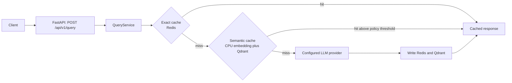

# CachePilot

CachePilot is a containerized semantic caching service for LLM requests. It checks Redis for an exact cache entry, checks Qdrant for a semantically similar entry, and calls the configured LLM only on a miss.

The default provider is Google Gemini. Semantic embeddings use `sentence-transformers/all-MiniLM-L6-v2` locally on CPU. NVIDIA drivers and CUDA are not required.

## What it does

- Redis exact cache and Qdrant semantic cache
- Tenant-scoped cache namespaces
- Cache identity that includes tenant, system-prompt hash, model, and temperature
- Query-aware cache policies for stable, time-sensitive, classification, and creative requests
- TTL and opt-in stale response handling
- Tenant cache invalidation by tag or query prefix
- Gemini, OpenAI, and Anthropic provider implementations
- Prometheus-compatible metrics for hits, misses, near misses, stale hits, false hits, latency, and estimated savings
- PII-redacted, bounded audit trail
- Docker Compose development environment and production Compose template
- Deterministic, dependency-free load benchmark

## Architecture



Exact matching is attempted before semantic matching. Semantic entries are filtered by tenant namespace. Cache policy is derived from the request text and temperature:

| Request type | Similarity threshold | TTL behavior | Stale responses |
|---|---:|---|---|
| Stable | configured default, `0.85` by default | configured default, `3600` seconds by default | 900-second opt-in window |
| Time-sensitive | `0.94` | maximum 300 seconds | disabled |
| Classification | `0.80` | configured default | 300-second opt-in window |
| Creative or temperature `>= 1.0` | `0.97` | maximum 900 seconds | disabled |

## Quick start

Prerequisites: Docker Desktop with Compose and a Gemini API key from Google AI Studio.

```bash
git clone https://github.com/jay15git/RAG-Cache.git
cd RAG-Cache
cp .env.example .env
```

Set `GEMINI_API_KEY` in `.env`. Keep `DEFAULT_LLM_PROVIDER=gemini` and `DEFAULT_MODEL=gemini-2.0-flash` unless you intend to configure another provider.

```bash
docker compose up --build -d
curl http://localhost:8000/ready
open http://localhost:8000/docs
```

The first semantic request downloads the CPU embedding model into the Docker volume. This is a one-time download for that volume and can take several minutes depending on the network.

Stop the local stack with:

```bash
docker compose down
```

`docker compose down -v` also deletes local Redis, Qdrant, and embedding-model volumes.

## Make a request

```bash
curl -X POST http://localhost:8000/api/v1/query \
  -H 'Content-Type: application/json' \
  -d '{
    "query": "Explain semantic caching in two sentences.",
    "tenant_id": "demo",
    "tags": ["documentation"],
    "use_cache": true,
    "use_semantic_cache": true,
    "system_prompt_hash": "support-v1",
    "temperature": 0.2
  }'
```

The first request is a miss and populates both caches. Repeating the same request should return `cache_info.cache_type: "exact"`. A similar request can return `"semantic"` when it clears the applicable policy threshold.

## API surface

| Method | Endpoint | Purpose |
|---|---|---|
| `GET` | `/health` | Liveness response |
| `GET` | `/ready` | Redis, Qdrant, and configured-provider readiness |
| `GET` | `/docs` | Interactive OpenAPI documentation |
| `POST` | `/api/v1/query` | Process one LLM request through the cache |
| `GET` | `/api/v1/metrics` | JSON operational metrics |
| `GET` | `/api/v1/metrics/prometheus` | Prometheus exposition format |
| `DELETE` | `/api/v1/admin/cache/{tenant_id}` | Invalidate a tenant, optionally by `tag` or `prefix` |

See [API.md](docs/API.md) for request and response schemas.

## Benchmark

Run the deterministic benchmark inside the API container:

```bash
docker compose exec -T api python scripts/load_test.py \
  --requests 2000 \
  --repeat-ratio 0.6 \
  --tenants 3 \
  --miss-latency-ms 25 \
  --seed 42
```

Current local reference run:

| Metric | Result |
|---|---:|
| Requests | 2,000 |
| Cache hit rate | 61.45% |
| P50 | 0.024 ms |
| P75 | 26.071 ms |
| P95 | 29.618 ms |
| P99 | 30.348 ms |
| Estimated tokens avoided | 614,500 |

This benchmark intentionally models a 25 ms miss and an in-memory near-zero hit. It is useful for regression checks and comparing cache behavior. It is not a production Gemini latency or cost measurement.

## Verification

```bash
docker compose exec -T api pytest -q tests/unit tests/load --disable-warnings --no-cov
docker compose exec -T api python scripts/load_test.py --requests 2000 --repeat-ratio 0.6 --tenants 3
curl http://localhost:8000/ready
```

Latest local verification: `1187 passed, 2 skipped` for unit and load tests.

## Configuration and deployment

- [Configuration](docs/CONFIGURATION.md)
- [Architecture](docs/ARCHITECTURE.md)
- [API reference](docs/API.md)
- [Development](docs/DEVELOPMENT.md)
- [Testing](docs/TESTING.md)
- [Deployment](docs/DEPLOYMENT.md)
- [Performance and benchmark methodology](docs/PERFORMANCE.md)
- [Troubleshooting](docs/TROUBLESHOOTING.md)

## Current scope

CachePilot exposes its own `/api/v1/query` schema. It is not yet an OpenAI-compatible `/v1/chat/completions` proxy and does not implement streaming responses. The provider selected for a request is controlled by `DEFAULT_LLM_PROVIDER`; the optional request `provider` field is accepted by the schema but is not currently used for per-request routing.
