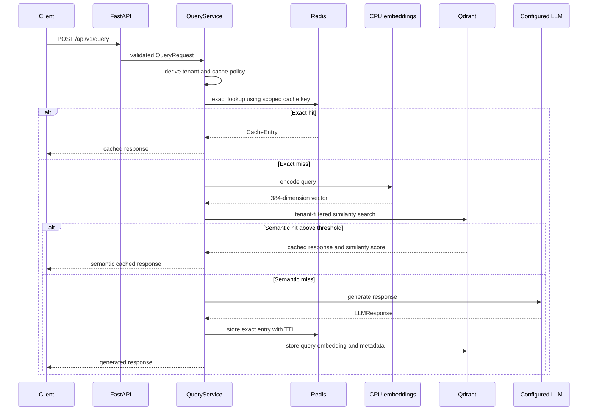

# CachePilot architecture

## Components

| Component | Responsibility |
|---|---|
| FastAPI | Validates requests and exposes query, health, metrics, and invalidation endpoints. |
| `QueryService` | Applies cache policy, coordinates cache lookups, calls the LLM on a miss, and writes new entries. |
| Redis | Stores exact cache entries with TTL. |
| Qdrant | Stores query embeddings and metadata for semantic similarity search. |
| `EmbeddingGenerator` | Loads `all-MiniLM-L6-v2` locally and produces 384-dimension CPU embeddings. |
| LLM provider factory | Creates Gemini, OpenAI, or Anthropic provider from application configuration. |
| Prometheus registry | Records cache decisions, latency, token use, and estimated savings. |
| Audit service | Keeps a bounded audit trail after redacting common PII and secret-like values. |

## Request flow



## Cache identity and isolation

Exact cache identity is derived from:

```text
tenant namespace + query + system_prompt_hash + model + temperature
```

This prevents exact entries generated for one tenant, model, prompt version, or temperature setting from being returned in another context. Semantic Qdrant searches also filter on the tenant namespace.

The cache does not infer or hash an actual system prompt. Clients supply `system_prompt_hash`, usually a stable hash or version string owned by the calling application.

## Cache policy

`app/cache/policy.py` classifies a request from query keywords and temperature. The policy yields a semantic threshold, TTL, and stale window. It is deterministic and deliberately simple so it can be inspected and changed without a training pipeline.

| Classification | Trigger | Threshold | Maximum TTL | Stale window |
|---|---|---:|---:|---:|
| Stable | default | configured threshold | configured TTL | 900 seconds |
| Time-sensitive | words such as `latest`, `today`, `price`, `weather`, `news` | 0.94 | 300 seconds | 0 |
| Classification | words such as `classify`, `yes or no` | 0.80 | configured TTL | 300 seconds |
| Creative | creative keywords or temperature at least 1.0 | 0.97 | 900 seconds | 0 |

Stale entries are served only when the caller sets `allow_stale: true`. CachePilot does not currently refresh stale entries in a separate background request; the next non-stale request follows the normal miss path.

## Deployment topology

The development Compose stack includes one API container, Redis, and Qdrant. The API image installs CPU-only PyTorch and runs as a non-root user. A named Hugging Face cache volume prevents repeat embedding-model downloads.

The production Compose file provides an API, Redis, Qdrant, and Nginx topology. It is a deployment template, not a hardened managed-production reference. Add authentication, TLS certificates, a secret manager, backups, and managed datastore controls before public deployment.

## Observability

`/api/v1/metrics/prometheus` exports request and cache metrics. Dashboard definitions are available in `app/monitoring/grafana.py`; Grafana itself is not started by either Compose file. This distinction matters when deploying monitoring.

## Current boundaries

- API schema is CachePilot-specific, not OpenAI Chat Completions compatible.
- Streaming responses are not implemented.
- Per-request `provider` selection is not wired into dependency creation; the default provider is configured with `DEFAULT_LLM_PROVIDER`.
- Semantic embeddings are local CPU embeddings, not OpenAI embeddings.
