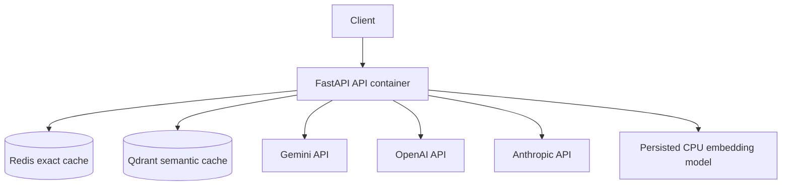
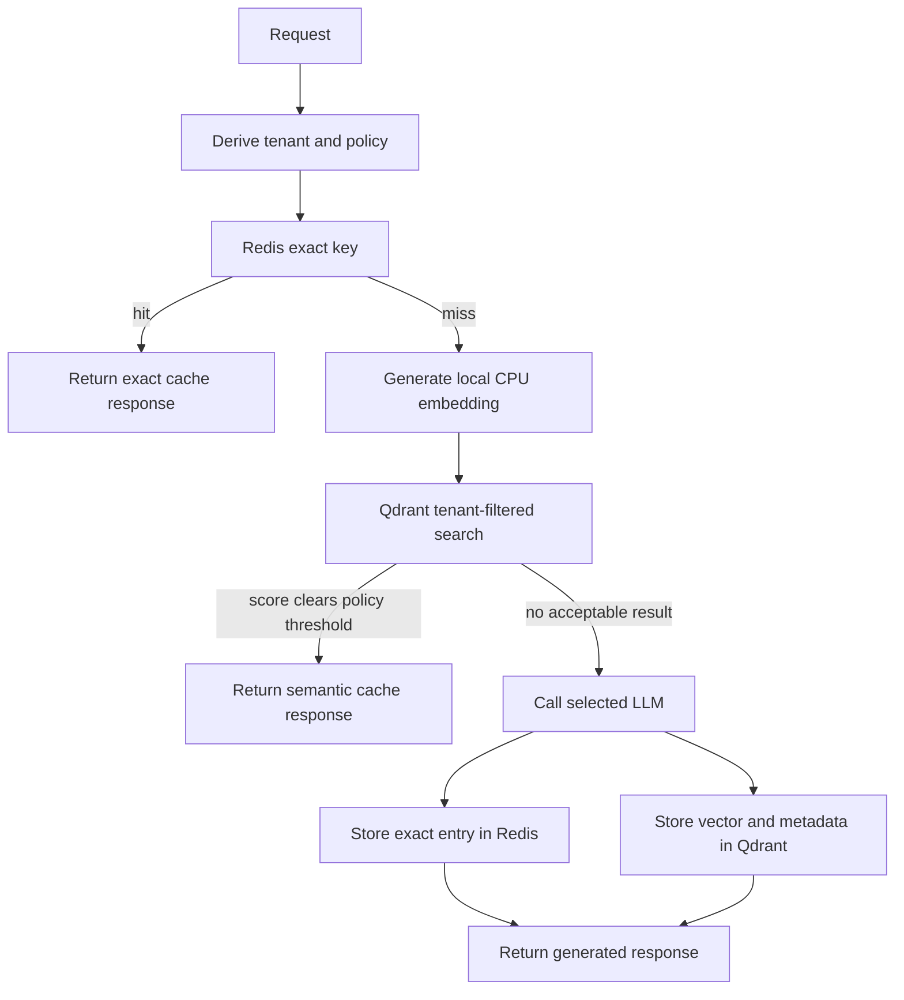

# CachePilot diagrams

## Deployment view

Only one provider is selected at runtime through `DEFAULT_LLM_PROVIDER`. Gemini is the default.

## Cache decision view

Exact keys include the request tenant, system-prompt hash, model, and temperature. Qdrant semantic queries are scoped by tenant namespace.
